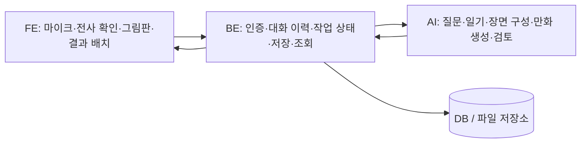

# BE 개발자용 AI 연동 인수인계

작성일: 2026-11-06  
기준: `WOOWANGTHON_TEAM_22_AI` / `ai_talk` / `88581d9`  
대상: BE 담당자 및 FE와 저장·조회 계약을 맞추는 개발자

이 문서는 현재 코드에서 동작하는 기능과 BE에서 추가해야 할 기능을 구분해 정리한 자료입니다. 아래의 **권장 저장 구조·작업 상태·BE 설정 이름은 설계 제안이며, 이미 구현된 BE API나 DB가 아닙니다.** AI 서버의 실제 요청 형식은 `server.py`, `models.py`, `visual_models.py`와 실행 중인 `/openapi.json`을 기준으로 합니다.

## 1. 먼저 알아야 할 핵심

1. AI 서버는 세션과 대화를 기억하지 않습니다. 질문·일기 요청마다 BE가 순서가 유지된 전체 `messages`를 보내야 합니다.
2. AI 서버에는 사용자 인증, 날짜별 일기 저장·조회, 이미지 영구 저장 기능이 없습니다. 모두 BE 담당입니다.
3. 현재 결과 화면은 **왼쪽: 아이가 직접 그린 원본 그림 + 확인한 일기 / 오른쪽: 같은 일기로 만든 AI 4컷 만화**입니다.
4. 원본 그림은 FE 그림판의 PNG입니다. AI 그림으로 덮어쓰면 안 됩니다. 현재 개발 화면은 이 PNG를 AI 서버에 보내지 않습니다. 제품에서는 FE→BE 업로드·저장 경로를 별도로 연결해야 합니다.
5. AI가 생성한 일기는 초안입니다. 사용자가 확인·수정한 최종 일기를 따로 보존하고, 그 버전으로 만화를 요청합니다.
6. `/api/visual-story/image`는 **HTTP 200이어도 `status=failed` 또는 `rejected`일 수 있습니다.** 상태 필드를 확인해야 합니다.
7. `imageUrl`은 HTTPS 파일 주소가 아니라 **PNG/JPEG base64 데이터 URL**입니다. BE가 파일로 저장하고 FE용 조회 URL을 발급해야 합니다.
8. `source_ids`는 DB ID가 아닙니다. 일기 API와 만화 API에서 가리키는 배열도 서로 다릅니다.
9. `diary_hash`와 `scene_key`는 무결성 비교용 값입니다. 사용자 인증·소유권 검증·중복 요청 방지 기능은 아닙니다.
10. 현재 마이크 대화는 말이 끝난 뒤 발화를 전사하는 방식입니다. WebSocket이나 실시간 스트리밍 STT API는 구현되어 있지 않습니다.

## 2. 현재 구현 범위와 책임 분리



| 기능 | FE | BE | 현재 AI 구현 |
| --- | --- | --- | --- |
| 대화 시작·후속 질문 | 화면·입력·질문 표시 | 세션 소유권·메시지 순서 관리, 전체 대화 전달 | 질문과 종료 신호 반환 |
| 마이크 입력 | 녹음·말 끝 감지 | 파일 제한·중계·실패 상태 관리 | 발화 파일을 한국어 텍스트로 전사 |
| 전사 확인 | 인식 결과 수정·확인 | 초안과 확인된 발언 구분·저장 | 초안임을 알리는 값 반환 |
| 일기 만들기 | 일기 수정·확인 UI | 대화 스냅샷·초안·최종본 저장 | 아이 말투의 일기와 근거 반환 |
| 직접 그린 그림 | 그림판·원본 PNG 생성 | 업로드·파일 저장·소유권 검증 | 현재 이 원본을 받거나 수정하지 않음 |
| 그림일기 합치기 | 원본 그림과 일기 배치 | 둘의 버전·연결 관계 보관 | 합성 파일 저장 API 없음 |
| 4컷 만화 | 2×2 배치·진행 표시·최종 확인 | 장면별 작업·재사용·파일 저장 | 원문 장면 구성과 단일 컷 생성·검토 |
| 날짜별 기록 | 달력·목록·상세 화면 | 날짜 기준·DB·조회·수정·삭제 | 없음 |
| HTML/PDF 출력 | 개발 화면은 HTML 다운로드·브라우저 인쇄 지원 | 서버 파일 보관이 필요하면 별도 구현 | 서버 PDF 생성 API 없음 |

`/dev/voice`는 AI 담당자의 로컬 연결 테스트 도구입니다. FE·BE를 우회해 AI 서버를 직접 호출하는 개발 화면이며, 제품 전체가 연결되었다는 뜻은 아닙니다.

## 3. 개발 환경과 주소

같은 Mac에서 BE와 AI를 실행한다면 기본 AI 주소는 다음과 같습니다.

```text
AI 기본 주소: http://127.0.0.1:8002
API 문서:    http://127.0.0.1:8002/docs
OpenAPI:     http://127.0.0.1:8002/openapi.json
개발 화면:   http://127.0.0.1:8002/dev/voice
```

- `GET /`가 404인 것은 정상입니다. 제품 홈페이지를 제공하지 않습니다.
- 기본 `python server.py`는 **127.0.0.1에만 바인딩**합니다. 다른 PC나 컨테이너의 BE가 그대로 접속할 수 없습니다.
- 다른 PC의 `127.0.0.1`은 그 PC 자신입니다. Docker 컨테이너의 `localhost` 역시 해당 컨테이너입니다.
- 다른 프로세스와 8002 포트를 동시에 사용하면 서버가 시작되지 않습니다. 이전 서버를 먼저 종료합니다.
- AI 서비스에는 CORS 설정이 없습니다. 제품 FE→BE→AI 흐름으로 연결합니다.
- AI API 자체의 인증 미들웨어는 없습니다. BE가 인증·권한을 확인하고 AI 서비스는 신뢰할 수 있는 내부 경로로 제한해야 합니다.

BE 설정 예시입니다. 이 변수는 **BE에서 별도로 정의할 이름**이며 AI 서버가 읽는 기존 설정이 아닙니다.

```dotenv
AI_BASE_URL=http://127.0.0.1:8002
```

Docker Compose에서 AI 서비스 이름을 `ai`로 정했다면 `http://ai:8002` 같은 주소를 사용할 수 있습니다. 이 경우 AI 컨테이너의 실행 바인딩도 조정해야 합니다. 다음은 내부 네트워크에서 실행할 때의 명령 예시이며, 현재 저장소에 Compose 구성이 있는 것은 아닙니다.

```bash
python -m uvicorn server:app --host 0.0.0.0 --port 8002
```

인증이 없는 상태로 위 포트를 공개 인터넷에 직접 노출하지 마세요.

## 4. AI 서버 설정

| 기능 | 기본 설정 | 비고 |
| --- | --- | --- |
| 실제 호출 / 체험 | `AI_MODE=openai` / `AI_MODE=mock` | `openai`라는 기존 이름이 실제 호출 모드라는 뜻으로 남아 있음 |
| 대화·일기 | `TEXT_PROVIDER=groq` | Groq 키 사용 |
| 음성 인식 | `STT_PROVIDER=groq` | 같은 Groq 키 사용 |
| 만화 이미지 생성 | `IMAGE_PROVIDER=cloudflare` | Cloudflare 토큰·계정 ID 필요 |
| 이미지 검토 | `VISION_PROVIDER=groq` | 같은 Groq 키 사용 |
| 서버 음성 출력 | `TTS_PROVIDER=disabled` | 기본으로 꺼져 있음. 선택 시 OpenAI TTS |
| 개발 화면 | `ENABLE_VOICE_DEMO=1` | 배포 환경에서는 0 권장. 개발 경로는 로컬 요청만 허용 |

실제 키는 AI 서버의 `.env` 또는 실행 환경에서 관리합니다. BE가 AI 서버를 중계 호출하는 구성이라면 BE·FE에 Groq/Cloudflare 키를 복사할 필요가 없습니다. AI 요청 JSON에도 키를 넣지 않습니다.

`.env.example`은 설정 예시이고, `.env`는 Git 추적 대상이 아닙니다. 실행 환경변수는 `.env`보다 우선합니다. 키·모델을 바꾼 뒤에는 AI 서버를 재시작하세요. 클라이언트에 이전 키가 캐시되어 있을 수 있습니다.

```bash
source .venv/bin/activate
python -m pip install -r requirements.txt
python check_setup.py
python server.py
```

`check_setup.py`와 `/api/status`는 키 존재 여부만 검사합니다. 잔액·모델 권한·전사·이미지 생성 성공을 보장하지 않습니다.

## 5. 제공되는 API 9개

JSON 요청은 `Content-Type: application/json`입니다. 전사만 multipart입니다. 문서에 없는 JSON 필드는 거절하므로 `userId`, `diaryId`, `date`, DB 메시지 ID 등을 AI 요청 본문에 추가하지 마세요. BE 내부에서 별도로 관리합니다.

| 메서드·경로 | 요청 | 핵심 응답 | 사용할 때 |
| --- | --- | --- | --- |
| GET `/api/status` | 없음 | `mode`, `configured` | 로컬 프로세스·설정 존재 여부 확인 |
| POST `/api/chat` | `messages` | `question`, `finished`, `mock`, `fallback` | 첫 질문·후속 질문 |
| POST `/api/diary` | `messages` | `text`, `pages`, `sources`, 확인·대체 상태 | 일기 초안 |
| POST `/api/transcribe` | multipart `file` | `text`, `requires_confirmation`, `mock` | 발화 전사 |
| POST `/api/voice-chat` | `messages` | 질문 + MP3 base64 또는 음성 오류 | 서버 TTS를 함께 쓸 때 |
| POST `/api/speech` | `text` | `audio/mpeg` 바이너리 | 확정 문장 읽기 |
| POST `/api/visual-story` | 확인한 `diary_text`, `format` 등 | `diary_hash`, 원문 조각, 장면 구성 | 현재 화면은 `comic4` 사용 |
| POST `/api/visual-story/image` | 확인한 일기·해시·장면 근거 | 단일 컷 상태·이미지 데이터 | 4컷을 장면별 생성 |
| POST `/api/image` | 확인한 페이지 `text` | 이미지 또는 `rejected` | 호환용 단일 페이지 경로. 현재 4컷 흐름의 주 경로가 아님 |

### 5-1. 첫 질문과 대화 이어가기

첫 질문 요청:

```json
{"messages": []}
```

실제 호출 모드의 첫 질문 응답:

```json
{
  "question": "오늘은 무슨 일이 있었어?",
  "finished": false,
  "mock": false,
  "fallback": false
}
```

첫 질문은 고정 문장이라 외부 API를 호출하지 않습니다. 이것만으로 실제 AI 연결이 성공했다고 판단하면 안 됩니다.

다음 질문 요청:

```json
{
  "messages": [
    {"role": "assistant", "text": "오늘은 무슨 일이 있었어?"},
    {"role": "child", "text": "친구랑 공놀이를 했어."}
  ]
}
```

BE는 반환된 `question`을 `assistant` 메시지로 보관하고, 다음 확인된 답변을 `child`로 추가합니다. 요청에는 매번 전체 배열을 보냅니다. `user`나 `system` 역할은 허용하지 않습니다.

- `finished=true`: 질문을 끝내자는 신호입니다. 일기 저장이 완료되었다는 뜻이 아닙니다.
- `fallback=true`: 질문 검토가 통과하지 못해 기본 질문으로 대체한 상태입니다. HTTP 오류와 구분합니다.
- 현재 AI는 메시지 순서의 소유권이나 요청 중복을 검사하지 않습니다. BE가 한 세션의 요청을 순서대로 처리하세요.

### 5-2. 일기 초안과 사용자 확정본

요청 구조는 `/api/chat`과 같습니다.

```json
{
  "messages": [
    {"role": "assistant", "text": "오늘은 무슨 일이 있었어?"},
    {"role": "child", "text": "친구랑 공놀이를 했어."},
    {"role": "assistant", "text": "그때 어떤 기분이 들었어?"},
    {"role": "child", "text": "재미있었어."}
  ]
}
```

응답 형태 예시입니다. 실제 모델의 문장·페이지 분할은 달라질 수 있습니다.

```json
{
  "text": "친구랑 공놀이를 했다. 재미있었다.",
  "pages": [
    {"text": "친구랑 공놀이를 했다.", "source_ids": [1], "imageUrl": null},
    {"text": "재미있었다.", "source_ids": [3], "imageUrl": null}
  ],
  "sources": [
    {"id": 1, "text": "친구랑 공놀이를 했어."},
    {"id": 3, "text": "재미있었어."}
  ],
  "fallback": false,
  "requires_confirmation": true,
  "mock": false
}
```

검토된 문장들은 본문에서 공백으로 연결합니다. `fallback=true`이면 발언별 줄바꿈을 유지한 원문을 돌려줍니다. 화면에서 모든 본문이 항상 한 줄이라고 가정하지 마세요.

중요한 구분:

- `sources[].id`, `pages[].source_ids`: **해당 요청의 messages 배열 인덱스**입니다. 위 예시에서는 1과 3입니다.
- 원문 발언 번호는 DB 메시지 PK가 아닙니다. 생성 당시의 메시지 배열 스냅샷과 PK 대응표를 보관해야 나중에도 근거를 찾을 수 있습니다.
- `pages`는 글의 구성 정보이며 날짜별 저장 목록이나 완성된 만화가 아닙니다. `pages[].imageUrl`은 이 API에서 생성되지 않습니다.
- `fallback=true`는 mock 또는 일기 내용 검토 실패일 수 있습니다. 공급자 연결 실패까지 항상 원문으로 대체해 주는 것은 아닙니다. 연결 실패는 503 등이 될 수 있습니다.
- `requires_confirmation=true`는 초안임을 뜻합니다. BE는 `generated_text`와 `approved_text`를 나누고 실제 사용자 확인 이력을 관리하세요.
- 사용자가 초안을 수정하면 기존 `source_ids`가 수정본의 모든 문장을 검증한다고 주장하면 안 됩니다. 생성본의 근거와 사용자 수정 내역을 별도로 보존합니다.

### 5-3. 음성 입력

```bash
curl --request POST 'http://127.0.0.1:8002/api/transcribe' \
  --form 'file=@recording.m4a;type=audio/mp4'
```

요청 필드 이름은 `file`입니다. BE HTTP 라이브러리의 multipart 기능을 사용해 boundary를 생성하세요. JSON base64를 보내는 API가 아닙니다.

```json
{
  "text": "친구랑 공놀이를 했어.",
  "requires_confirmation": true,
  "mock": false
}
```

전사 결과는 초안입니다. FE에서 확인·수정한 후에만 BE의 확정된 `child` 메시지로 추가합니다. 같은 발화의 재전송으로 대화가 중복되지 않도록 발화 ID는 BE에서 관리합니다.

현재 개발 화면은 브라우저에서 최대 30초씩 녹음하고 기본 3초의 말 끝 대기 후 파일을 자동 전송합니다. **30초와 말 끝 대기는 FE 도구의 설정이며 AI API 자체의 음성 길이 제한이 아닙니다.** AI 서버는 파일 크기 8 MiB 등을 검사합니다.

원본 음성을 영구 저장하는 기능은 AI 서버에 없습니다. 제품에서 보관이 필요하다면 저장 여부·보관 범위를 팀에서 정하고 BE에 구현해야 합니다.

### 5-4. 음성 출력의 부분 실패

현재 개발 화면은 `/api/chat`의 질문을 브라우저 `SpeechSynthesis`로 읽습니다. `TTS_PROVIDER=disabled`를 유지해도 이 방식은 사용할 수 있습니다. FE 기기 음성과 서버 TTS는 별개입니다.

서버 TTS를 선택하면 `/api/voice-chat`은 질문 생성 후 음성 생성을 시도합니다. 음성만 실패하면 HTTP 200으로 다음과 같은 응답을 줄 수 있습니다.

```json
{
  "question": "공놀이할 때 어떤 일이 있었어?",
  "finished": false,
  "mock": false,
  "fallback": false,
  "audio_base64": null,
  "audio_mime_type": null,
  "audio_error": "음성 출력을 사용할 수 없다는 안내"
}
```

이 경우 질문은 성공한 결과입니다. 질문을 보존하고 음성 오류만 표시합니다. 음성을 재시도하려고 `/api/voice-chat` 전체를 다시 요청하면 질문과 비용이 중복될 수 있습니다.

서버 음성만 다시 요청하려면 다음 경로를 사용합니다.

```json
{"text": "이미 확정한 질문 문장"}
```

이를 `POST /api/speech`로 보내면 성공 시 JSON이 아니라 MP3 바이너리가 반환됩니다. `TTS_PROVIDER=disabled`일 때는 503입니다. `/api/voice-chat`은 음성 업로드를 받는 경로가 아닙니다.

## 6. 원본 그림일기와 4컷 연결

### 6-1. 직접 그린 그림 저장

현재 FE 개발 도구의 원본은 960×600 그림판에서 만든 PNG 데이터 URL입니다. 그림과 확인한 일기를 브라우저에서 합치며 외부 AI에 원본 그림을 전송하지 않습니다.

제품 BE에는 다음 작업이 필요합니다.

1. 인증된 사용자가 자신의 일기에 그림을 올리는 업로드 경로 마련
2. 파일 형식·크기·실제 디코딩 가능 여부 검사
3. 원본 PNG를 별도 파일 객체로 저장
4. 원본 그림 버전과 확정 일기 버전의 연결 저장
5. FE가 그림과 글을 다시 불러올 수 있는 조회 응답 제공

이 업로드 경로는 현재 AI API 9개에 포함되어 있지 않습니다. AI 서버에 `drawing` 같은 필드를 임의로 추가해서 보내면 422가 발생합니다.

### 6-2. 확인한 일기로 장면 구성

```json
{
  "diary_text": "친구랑 공놀이를 했다. 재미있었다.",
  "confirmed": true,
  "format": "comic4"
}
```

`POST /api/visual-story`로 전송합니다. 응답의 다음 항목을 저장합니다.

| 필드 | BE가 알아야 할 의미 |
| --- | --- |
| `diary_text` | 서버가 앞뒤 공백을 제거한 기준 일기 |
| `diary_hash` | 위 기준 일기의 SHA-256. 후속 요청에서는 응답 값을 그대로 사용 |
| `sources` | 이 API가 일기를 나눈 원문 조각 목록 |
| `comic4.scenes` | 순서가 있는 4개 장면 |
| `scene_id` | 해당 구성의 장면 ID. DB 전역 고유 ID가 아님 |
| `caption` | 표시할 장면 글. 이 값을 다른 문장으로 자동 교체하지 않음 |
| `source_ids` | 이 응답의 `sources` 인덱스. 대화 메시지 인덱스가 아님 |
| `repeated`, `reuse_scene_id` | 반복 컷과 재사용할 원본 장면 |
| `planning_mode` | `model`, `deterministic`, `fallback`, `mock` 중 하나 |
| `notices` | 원문이 짧아 장면을 반복하는 등의 안내 |

두 문장으로 된 일기라면 원문 번호는 보통 `[0]`, `[1]`이며, 나머지 컷은 마지막 장면을 반복할 수 있습니다. 반복 컷을 새로운 사건이나 시간 경과로 저장·표시하지 않습니다.

장면 구성 응답에는 실제 이미지가 아직 없습니다. `imageUrl=null`이 정상입니다. 이미지 생성은 다음 단계입니다. `planning_mode=fallback`이면 장면 묶기 요청이나 검토에 실패해 원문 순서로 나눈 상태이며, 모든 공급자가 정상이라는 뜻은 아닙니다.

### 6-3. 단일 컷 이미지 생성

```json
{
  "diary_text": "친구랑 공놀이를 했다. 재미있었다.",
  "diary_hash": "앞_단계에서_받은_실제_64자리_해시로_교체",
  "format": "comic4",
  "source_ids": [0],
  "confirmed": true
}
```

`POST /api/visual-story/image`로 보냅니다. 위 해시 자리의 설명 문구를 그대로 보내면 422입니다. 반드시 장면 구성 응답의 값을 사용하세요.

응답에서 `status`, `imageUrl`, `error`를 함께 확인합니다.

| `status` | 이미지 | 처리 |
| --- | --- | --- |
| `generated` | 데이터 URL | 원문·해시·장면 근거를 확인하고 파일 저장 |
| `rejected` | null | 원문 일치 검토에서 거절됨. 글은 유지하고 해당 컷만 재시도 선택 제공 |
| `failed` | null | 생성 또는 검토에 실패함. `error` 확인. 이미 완료된 컷은 유지 |
| `mock` | null | 체험 모드이므로 실제 그림이 없음 |

위 네 상태는 모두 HTTP 200으로 반환될 수 있습니다. 성공 판정은 HTTP 코드만으로 하지 마세요.

반복 컷은 `reuse_scene_id`의 저장된 그림을 참조하게 합니다. 동일한 컷에 이미지 API를 다시 호출할 필요가 없습니다. 원본 컷이 실패했으면 원본만 재시도하고 참조하는 반복 컷을 함께 갱신합니다.

현재 기본 경로는 단일 컷마다 Groq 영문 묘사 → Cloudflare 그림 생성 → Groq 원문 비교를 수행합니다. 자동 검토에 통과해도 사용자 확인은 필요합니다. 아이가 직접 그린 원본 캐릭터를 그대로 복제하는 이미지 편집 기능은 아닙니다.

### 6-4. 해시와 버전이 바뀌는 경우

- 일기 본문을 바꾸면 장면 구성을 다시 요청하고 새 `diary_hash`로 작업합니다.
- 줄바꿈·문장부호·내부 공백도 해시에 영향을 줍니다. 후속 요청 전에 BE가 임의로 정규화하지 마세요. 응답의 `diary_text`를 그대로 보관·전송하는 것이 안전합니다.
- `/api/diary`의 근거 번호와 `/api/visual-story`의 근거 번호를 혼용하지 마세요.
- 비연속·역순·중복 `source_ids`는 거절됩니다. 구성 응답에서 받은 배열을 그대로 사용합니다.
- 사용자가 직접 그린 그림만 바꾸고 확정 일기 본문이 같다면 현재 만화는 재사용할 수 있습니다. 만화는 원본 PNG를 입력으로 사용하지 않기 때문입니다.
- 이미 요청 중인 일기를 수정하거나 대화를 바꾸면 이전 응답이 도착해도 현재 버전에 붙이면 안 됩니다. BE가 요청 시점의 일기 버전과 현재 버전을 비교하세요.

### 6-5. 데이터 URL을 파일로 보관

`imageUrl` 예시:

```text
data:image/jpeg;base64,...
data:image/png;base64,...
```

BE의 권장 처리:

1. 허용된 PNG/JPEG 데이터 URL인지 확인합니다.
2. base64를 디코딩하고 바이너리 크기·실제 이미지 형식을 검사합니다.
3. 저장소에 업로드하고 내부 객체 키를 기록합니다.
4. FE에는 권한에 맞는 조회 URL을 제공합니다.
5. 만화 컷에 `diary_revision`, `diary_hash`, `scene_key`, `source_ids`, `caption`, 저장 객체를 연결합니다.

`imageUrl`은 임의의 원격 URL을 받아 다운로드하는 기능이 아닙니다. JSON/base64 응답은 바이너리보다 커지므로 BE HTTP 응답 크기와 프록시 제한도 맞춰야 합니다. 데이터 URL 전체를 서버 로그에 남기지 마세요.

## 7. 입력 제한과 실수하기 쉬운 값

| 항목 | 현재 제한 |
| --- | --- |
| `messages` | 최대 60개 |
| 각 메시지 `text` | 1~2,000자 |
| 대화 텍스트 합 | 최대 20,000자. 초과 시 현재 503 안내 |
| 메시지 `role` | `child`, `assistant`만 허용 |
| `/api/diary` 최소 입력 | 아이 발언 1개 이상 필요. 없으면 503 안내 |
| 일기 생성 후보 | 최대 20문장, 각 500자에 대한 내용 검사. 실패 시 원문 대체 가능 |
| 일기 응답 `pages` | 최대 6개. 만화 컷 수와 다른 값 |
| `diary_text` | 1~6,000자. 공백만 있는 장면 구성 입력 거절 |
| 일기 원문 조각 | 최대 80개 |
| `storybook_pages` | 1~6, 기본 4. `comic4`는 별도로 4컷 구성 |
| 단일 그림 `source_ids` | 1~80개, 유효한 연속 번호를 순서대로 전달 |
| `/api/image`의 `text` | 1~1,500자 |
| `/api/speech`의 `text` | 요청 길이 1~1,000자. 앞뒤 공백을 제거하며 공백만 입력 거절 |
| 음성 파일 | 최대 8 MiB = 8,388,608바이트 |
| 전사 결과 | 비어 있거나 2,000자 초과 시 503. 자동으로 잘라서 확정하지 않음 |

일기 API의 출력이 항상 6,000자 이내라고 보장되지는 않습니다. 특히 원문 대체 결과가 길면 만화 API 한도보다 클 수 있습니다. 이 경우 내용을 몰래 잘라 버리지 말고 사용자 확인을 받아 짧게 정리하거나 별도 일기로 나눕니다.

허용 음성 확장자는 `.webm`, `.mp4`, `.m4a`, `.wav`, `.mp3`, `.mpeg`, `.mpga`입니다. MIME도 확장자별로 검사하며 파라미터는 제거합니다. 예를 들어 `.m4a`에는 `audio/mp4`, `.webm`에는 `audio/webm`을 사용합니다. `application/octet-stream`은 현재 허용하지만 실제 형식 보장까지 해주는 것은 아닙니다. AI 서버의 검사는 크기·확장자·MIME 중심이므로 BE/프록시의 업로드 제한과 실제 파일 검증이 필요합니다.

## 8. 오류 응답과 재시도

AI 오류 응답은 두 가지 모양이 있습니다.

```json
{"error": "제공업체 키·한도·연결 등의 안내"}
```

```json
{"detail": "일기가 변경되었습니다. 장면 구성을 다시 요청해 주세요."}
```

| HTTP 코드 | 현재 발생 예 | BE 처리 |
| --- | --- | --- |
| 400 | 일기·장면 확인 누락, 빈 음성 | 입력·확인 흐름 수정 |
| 409 | 이미지 요청의 일기 해시 불일치 | 장면 구성부터 다시 요청 |
| 413 | 음성 파일 크기 초과 | FE에 더 짧은 녹음 안내 |
| 415 | 확장자·MIME 불일치 | 녹음 파일 형식 확인 |
| 422 | 잘못된 필드·자료형·길이·근거 번호 | BE 직렬화·검증 수정 |
| 502 | 일부 원본 OpenAI SDK 오류·모델 응답 형식 오류 | 응답 안내 확인, 무조건 반복 호출하지 않음 |
| 503 | 새 공급자 연결 계층의 키·권한·한도·네트워크 오류, 비활성 TTS, 입력 내용 처리 오류 | 원인을 구분해 사용자에게 안내 |
| 500 등 | 처리되지 않은 내부 오류·중계/프록시 오류 가능 | JSON 형식이 아닐 수도 있으므로 기본 오류 처리 필요 |

공급자가 401·429를 반환해도 현재 AI 서버의 새 공급자 계층은 공개 가능한 안내로 바꿔 **503**으로 반환할 수 있습니다. 따라서 503을 모두 잠깐 기다리면 해결되는 오류로 취급하면 안 됩니다. 현재 안정적인 기계용 `error_code` 필드는 없으며, 필요하면 팀에서 계약 확장을 먼저 합의해야 합니다.

재시도 원칙:

- 한 사용자·한 대화에 대해 질문 요청을 직렬화합니다. 같은 발언이 두 번 저장되지 않게 합니다.
- 잔액 부족·잘못된 키·권한 오류는 설정을 고치기 전까지 반복하지 않습니다.
- 한도 오류는 계정의 한도와 대기 시간을 확인합니다. 503이므로 공급자의 `Retry-After`가 그대로 전달된다고 가정하지 마세요.
- 실패한 컷만 재시도합니다. 성공한 그림을 유지하고 전체 만화를 처음부터 다시 만들지 않습니다.
- `rejected`도 이미 생성·검토 호출을 사용한 결과입니다. 비용이 없다는 뜻이 아닙니다.
- 요청 취소나 BE 타임아웃이 공급자의 작업·과금 취소를 보장하지 않습니다.
- AI 서버에는 결과 캐시, 생성 작업 ID, 중복 요청 잠금, `Idempotency-Key` 처리 기능이 없습니다. 같은 요청을 다시 보내면 재생성될 수 있습니다.
- `scene_key`가 같아도 AI 서버가 결과를 캐시해 준다는 뜻은 아닙니다. 중복 방지는 BE에서 `(소유 사용자, 일기 버전, 형식, 근거 번호, 생성 시도)` 등을 기준으로 관리합니다.

## 9. 대기 시간·작업 상태 권장안

현재 AI API는 동기 요청입니다. 작업을 등록하고 job ID를 돌려주는 비동기 작업 API는 없습니다.

Groq 호출은 단계별 기본 60초, Cloudflare 생성은 180초 대기 설정이며 한 컷에는 묘사·그림·검토 단계가 이어집니다. 이는 단계별 타임아웃이지 전체 요청 완료 시간 보장은 아닙니다. 개발 화면은 단일 이미지 요청을 최대 6분 기다립니다. BE/프록시가 30초 등으로 먼저 끊으면 AI 작업은 계속 진행될 수 있습니다.

제품에서 긴 요청을 안정적으로 처리하려면 **BE 작업 큐 + 상태 조회**를 추가하는 방식을 권장합니다. 아래는 BE 설계 제안입니다.

```text
일기: draft → awaiting_confirmation → approved
만화: planned → generating → completed / partially_failed / failed
컷:   pending → generating → generated / rejected / failed
```

- 이미지 생성은 우선 장면별 순차 처리로 시작합니다. 공급자 한도가 공유되므로 무제한 병렬 호출을 피합니다.
- 작업에 일기 버전과 요청 스냅샷을 묶습니다. 오래된 결과는 별도로 보관하거나 폐기하고 현재 일기에 덮어쓰지 않습니다.
- 서버 재시작 후 재개가 필요하면 작업 상태와 완료된 파일을 BE에 영구 저장합니다.
- 질문은 보통 생성·검토 2회, 일기는 보통 생성·검토 최대 2회, 이미지 한 컷은 묘사·생성·검토 호출을 사용합니다. 장면 묶기에도 모델 호출이 추가될 수 있습니다.
- 공급자 SDK의 자동 재시도는 기본 경로에서 꺼져 있으며, 다른 유료 공급자로 자동 전환하지 않습니다.

## 10. 권장 저장 데이터

다음은 현재 AI DB가 아니라 **BE에서 구현할 저장 설계 제안**입니다. 실제 컬럼명·관계는 BE 프레임워크에 맞춰 정하면 됩니다.

| 구분 | 권장 보관 값 | 이유 |
| --- | --- | --- |
| 대화 세션 | 소유 사용자/아이 ID, 세션 ID, 상태, 시작·종료 시각 | 접근 제어와 요청 순서 |
| 메시지 | 세션 ID, 순서, 역할, 확인한 원문, 발화 식별자 | 전체 대화 복원과 중복 방지 |
| 생성 스냅샷 | 생성 당시 전체 messages, 인덱스↔DB ID 대응 | `source_ids`의 의미 유지 |
| 전사 초안 | 인식 원문, 수정된 확정 문장, 확인 시각 | 초안과 실제 아이 발언 구분 |
| 일기 버전 | 생성 초안, 확정 본문, fallback, 확인 상태·시각 | 사용자 수정 보존과 만화 버전 연결 |
| 일기 날짜 | 사용자가 선택한 날짜, 기준 시간대, 생성 시각 | 사건 날짜와 생성 날짜를 혼동하지 않음 |
| 원본 그림 | 파일 객체 키, MIME·크기·가로세로, 버전 | 직접 그린 원본 보존 |
| 그림일기 연결 | 확정 일기 버전 ID + 원본 그림 버전 ID | 왼쪽 결과 재구성 |
| 장면 구성 | diary_hash, sources, scene_id, order, caption, source_ids, repeated, reuse_scene_id | 4컷 재구성·재사용 |
| 만화 컷 작업 | 상태, scene_key, 생성 시도, 오류, 저장 파일, 현재 버전 여부 | 부분 재시도·오래된 응답 방지 |
| 최종 확인 | 사용자가 확인한 결과 버전·시각 | 자동 생성과 최종 승인 구분 |

원본 그림·생성 그림·사용자 확정 글은 서로 다른 데이터로 보존합니다. 생성 오류가 나도 이미 저장한 원본과 일기를 삭제하지 않습니다.

AI API에는 사용자 ID·사건 날짜가 없고, 응답도 날짜를 확정하지 않습니다. 한국 서비스라면 날짜 경계를 `Asia/Seoul` 등 팀이 정한 시간대로 일관되게 처리하고, 파일 생성 시각을 일기 사건 날짜로 자동 사용하지 마세요.

## 11. 보관·접근·로그 주의점

현재 코드에 없는 부분이므로 제품 연결 전에 BE에서 마련해야 합니다.

- 로그인 사용자와 세션·일기·그림의 소유권 검사. 해시를 안다고 조회·수정 권한이 생기는 것은 아닙니다.
- AI 서비스 접근을 내부 경로로 제한하고 외부 요청에는 BE 인증·호출 한도 적용.
- 실제 API 키, 전사 원문, 대화 전문, 음성 base64, 이미지 데이터 URL을 일반 로그에 그대로 남기지 않기.
- 사용자 입력·생성 텍스트는 문자열로 렌더링하고 HTML로 직접 실행하지 않기.
- 파일 저장소의 원본 그림과 생성 이미지에 사용자별 접근 정책 적용.
- 보관·수정·삭제 정책을 정하고 DB와 파일 객체의 연결을 함께 처리.

현재 서비스는 성인 팀원의 개발·시연용으로 준비되었습니다. 실제 아동 대상 운영의 제공업체 연령·데이터 처리 조건이 승인되었다고 간주하면 안 됩니다. 해당 운영 준비는 별도로 확인해야 합니다.

## 12. BE 연동 완료 체크

### 연결과 대화

- [ ] 같은 PC/다른 PC/컨테이너에 맞는 AI 주소로 접속된다.
- [ ] 첫 고정 질문뿐 아니라 아이 답변이 포함된 실제 질문 요청까지 확인했다.
- [ ] 세션별 전체 메시지 순서와 DB ID 대응이 유지된다.
- [ ] 전사 결과는 사용자 확인 후에만 child 메시지로 저장된다.
- [ ] 중복 클릭·타임아웃 재시도로 발언·질문이 두 번 저장되지 않는다.
- [ ] finished와 fallback을 저장 완료나 공급자 정상 상태로 오해하지 않는다.

### 그림일기와 만화

- [ ] 생성 초안과 사용자 확정 일기를 별도로 저장한다.
- [ ] 원본 PNG를 따로 저장하고 AI 이미지로 덮어쓰지 않는다.
- [ ] 일기 API 근거 번호와 만화 API 근거 번호를 구분한다.
- [ ] 장면 구성 응답의 diary_text·diary_hash·source_ids를 그대로 후속 요청에 사용한다.
- [ ] HTTP 200에서도 status와 imageUrl, error를 확인한다.
- [ ] 반복 컷은 원본 이미지를 참조하고 불필요한 재생성을 하지 않는다.
- [ ] 본문 수정 후 늦게 도착한 이전 결과를 현재 일기에 붙이지 않는다.
- [ ] 완료된 컷을 유지하면서 실패한 컷만 재시도할 수 있다.
- [ ] 저장 후 새로고침·재접속해도 날짜별 일기·원본 그림·만화를 복원할 수 있다.

### 제한과 운영 준비

- [ ] 텍스트 길이·파일 크기·MIME 제한을 BE/프록시에도 맞췄다.
- [ ] 잔액/키/권한 오류와 일시적인 실패를 구분해 안내한다.
- [ ] 긴 이미지 요청의 타임아웃·작업 상태·동시 요청 제한을 정했다.
- [ ] TTS 비활성 또는 audio_error가 있어도 질문 텍스트는 유지한다.
- [ ] AI 키와 원문 데이터가 일반 로그·Git·FE 번들에 노출되지 않는다.
- [ ] 사용자별 접근 권한과 파일 보관·삭제 흐름을 확인했다.

## 13. 참고 파일과 검증 범위

- `server.py`: 9개 API 경로와 실제 HTTP 오류 처리
- `models.py`: 대화·일기·음성 자료형
- `visual_models.py`, `visual_story.py`: 장면·해시·반복 컷·이미지 결과
- `providers.py`, `.env.example`: 공급자별 연결·설정
- `devtools/voice/app.js`, `drawing.mjs`, `illustration.mjs`: 로컬 화면 연결 예시
- [기능별 공급자 설정](MULTI_PROVIDER_SETUP.md)
- [마이크 대화](LIVE_VOICE.md)
- [아이 그림일기와 4컷](CHILD_DRAWING_DIARY.md)

이 기준 코드에서는 Python 테스트 87개와 Node 테스트 21개가 통과했습니다. API 형식·원문 보존·부분 실패·반복 컷·그림판 원본·취소·파일 출력 처리에 대한 검사입니다. 실제 BE 프레임워크와의 연결, DB·인증·파일 저장, 실제 장치의 마이크·기기 음성, 모든 공급자의 운영 품질까지 검증되었다는 뜻은 아닙니다.

실제 구현된 BE가 준비되면 양쪽에서 요청·응답 샘플을 대조하고, 현재 없는 작업 ID·기계용 오류 코드·인증 방식·파일 업로드 계약을 함께 확정하면 됩니다.
